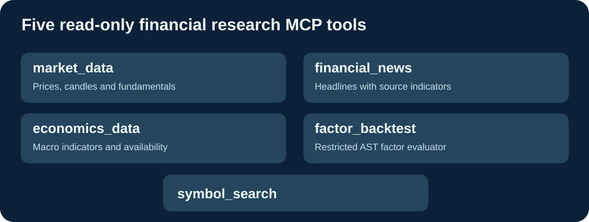

# Cloud9-Fincept-MCP

**Cinq outils financiers en lecture seule, MCP autonome et image GHCR précompilée.**

[English](README.md) · Français · [简体中文](README.zh-CN.md)

Le Fincept MCP officiel est un service hébergé soumis à un abonnement (https://fincept.in/enterprise/mcp). Cet adaptateur indépendant utilise des données de marché publiques et des bibliothèques Python, sans copier de code FinceptTerminal ni répliquer son service commercial.

## Fonctions

- market_data : OHLCV, prix récent valide, fondamentaux optionnels.
- financial_news : nouvelles financières et sources.
- economics_data : PIB, inflation, taux et chômage selon disponibilités.
- factor_backtest : évaluation d'expressions factorielles avec AST Python restreint.
- symbol_search : recherche de symboles financiers.

**Améliorations Cloud9** : sécurité anti-injection sur factor_backtest, JSON valide en présence de NaN, Host allowlist configurable par MCP_ALLOWED_HOSTS, tests de parité des cinq schémas et GHCR multiarchitecture créé par GitHub Actions. Mise à jour par Docker pull, sans compilation locale.

## Installation

Cloner https://github.com/GodsQuantum/Cloud9-Fincept-MCP, copier .env.example vers .env, configurer les hôtes autorisés, puis lancer docker compose -f compose.example.yaml up -d.

Endpoint : http://127.0.0.1:18765/mcp. Ne pas exposer publiquement sans passerelle authentifiée.

Code indépendant MIT, licences et conditions des données externes séparées. Aucune affiliation avec Fincept Corporation.
