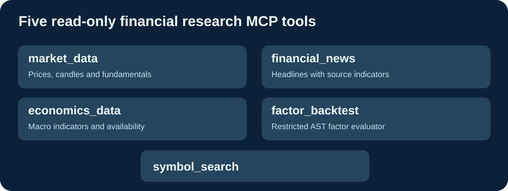

# Cloud9-Fincept-MCP

**Independent read-only market and factor research server, with five MCP tools and automatic GHCR distributions.**

English · [Français](README.fr.md) · [简体中文](README.zh-CN.md)

## Why this is independent

The commercial Fincept MCP (https://fincept.in/enterprise/mcp) is a hosted subscription service. This independently implemented, self-hosted set of five research tools uses public data and optional provider connections instead. It is neither a fork of FinceptTerminal, nor a copy of the official hosted API. No affiliation with Fincept Corporation is claimed.

| Tool | Preserved function |
|---|---|
| market_data | OHLCV history, latest valid quote, optional fundamentals |
| financial_news | Market headlines with data-source metadata |
| economics_data | GDP, inflation, unemployment, rate indicators where available |
| factor_backtest | Offline quantitative factor evaluation with a bounded expression grammar |
| symbol_search | Symbol lookup using supported public financial providers |

## Cloud9 improvements

- Preserves the five production tool names and argument schemas, guarded by regression tests.
- Restricted Python AST for factor calculations prevents arbitrary expression evaluation.
- Correct handling of missing Yahoo data and NaN candles, maintaining valid JSON.
- GitHub Actions builds ready-to-pull GHCR amd64/arm64 images, with no local pip compilation on production updates.
- Host allowlist configurable using MCP_ALLOWED_HOSTS, rather than embedded private LAN IPs.
- Safe configuration for authenticated MCP gateways; do not publicly expose network access to private sources.

## Installation

1. Clone https://github.com/GodsQuantum/Cloud9-Fincept-MCP.
2. Copy .env.example to .env and configure your own MCP_ALLOWED_HOSTS.
3. Run docker compose -f compose.example.yaml up -d.

The local MCP endpoint is http://127.0.0.1:18765/mcp.

**License:** independent adapter MIT; its third-party Python dependencies and market data providers retain their own terms. Fincept is a third-party trademark used descriptively. No affiliation, endorsement or account access.
