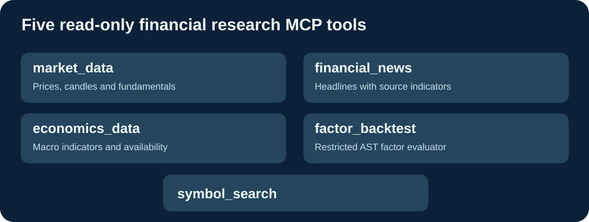

# Cloud9-Fincept-MCP

**五种只读金融研究 MCP 工具，通过 GitHub 构建预编译 GHCR 镜像。**

[English](README.md) · [Français](README.fr.md) · 简体中文

Fincept 的官方 MCP 是商业托管订阅服务（https://fincept.in/enterprise/mcp）。本项目独立开发，使用公开金融数据接口，不复制 FinceptTerminal 源码或商业 API，与 Fincept Corporation 无关联。

## 功能

- market_data：市场价格、OHLCV 历史和可选基本面。
- financial_news：财经新闻和数据来源。
- economics_data：通货膨胀、GDP、利率等宏观数据。
- factor_backtest：严格限制 Python AST 的因子表达式分析。
- symbol_search：金融市场代码搜索。

Cloud9 保留五个现有工具输入 Schema，使用 GitHub Actions 测试和发布 amd64/arm64 GHCR 镜像，并限制不安全表达式执行、处理无效 NaN 数据。服务器只需 Docker pull 即可更新，不需要本地编译。使用 MCP_ALLOWED_HOSTS 指定可信主机；仓库不包含私有 IP、密钥或账号。

安装：克隆 https://github.com/GodsQuantum/Cloud9-Fincept-MCP，复制 .env.example 为 .env，再运行 docker compose -f compose.example.yaml up -d。MCP 地址：http://127.0.0.1:18765/mcp。

独立代码 MIT；上游依赖与数据源条款独立适用。未经身份认证请勿暴露 MCP 服务。
